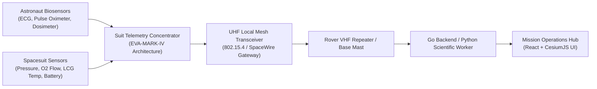

# Mars Pathfinder — Crew Telemetry & Biosensor Specification

> **DOCUMENT CLASSIFICATION: TECHNICAL SPECIFICATION**  
> **MISSION SUITE: MARS MISSION OPERATIONS & CREW SAFETY (PHASE 2)**  
> **STANDARDS ALIGNMENT: NASA-STD-3001 VOL 1 & 2 / NASA SP-2010-3407**  
> **DATA CATEGORY: SIMULATED EXPLORATION BIOMEDICAL TELEMETRY**  

---

## 1. Important Regulatory Notice & Disclaimer

> [!WARNING]
> **SIMULATED TELEMETRY ONLY — NOT REAL MEDICAL ADVICE**  
> All biomedical, physiological, and spacesuit telemetry data produced and displayed by the Mars Pathfinder platform are generated by computational planetary exploration algorithms for operational planning, scenario simulation, and trajectory modeling. They do **not** represent live human medical telemetry and must never be utilized as clinical diagnostic or medical advice.

---

## 2. Telemetry Architecture Overview

The Mars Pathfinder crew telemetry pipeline models the bio-energetic expenditure and life-support requirements of planetary surface explorers operating under Martian gravity ($g = 3.72076\text{ m/s}^2$) across challenging topographic slopes and variable atmospheric optical opacities.



---

## 3. Physiological Biosensor Metrics & Operational Thresholds

Physiological vitals are derived continuously as a function of the astronaut's active locomotory speed, terrain inclination angle (slope), environmental dust loading, and active medical status.

### 3.1 Metrics Baseline & Alert Thresholds

| Metric | Nominal Range | Warning Threshold | Critical Alarm Threshold | Primary Physiological Risk |
| :--- | :--- | :--- | :--- | :--- |
| **Heart Rate** | $60 - 100\text{ BPM}$ | $> 110\text{ BPM}$ or $< 50\text{ BPM}$ | $> 125\text{ BPM}$ or $< 40\text{ BPM}$ | Cardiac overexertion / Tachycardia / Arrhythmia |
| **Blood Oxygen ($\text{SpO}_2$)** | $95.0\% - 99.0\%$ | $90.0\% - 94.9\%$ | $< 90.0\%$ | Acute Hypobaric Hypoxia |
| **Respiration Rate** | $12 - 20\text{ BPM}$ | $21 - 28\text{ BPM}$ | $> 28\text{ BPM}$ or $< 8\text{ BPM}$ | Hyperventilation / Respiratory distress |
| **Core Body Temp** | $36.5^\circ\text{C} - 37.5^\circ\text{C}$ | $< 36.0^\circ\text{C}$ or $> 38.0^\circ\text{C}$ | $< 35.0^\circ\text{C}$ or $> 39.0^\circ\text{C}$ | Hypothermia / Hyperthermia |
| **Blood Pressure (Systolic)** | $105 - 130\text{ mmHg}$ | $131 - 150\text{ mmHg}$ | $> 150\text{ mmHg}$ or $< 85\text{ mmHg}$ | Hypertension / Hemorrhagic shock |
| **Blood Pressure (Diastolic)** | $65 - 85\text{ mmHg}$ | $86 - 95\text{ mmHg}$ | $> 95\text{ mmHg}$ or $< 55\text{ mmHg}$ | Peripheral vascular stress |
| **Fatigue Index** | $0\% - 45\%$ | $46\% - 75\%$ | $> 75\%$ | Physical exhaustion / Cognitive impairment |
| **Radiation Dose Rate** | $10 - 25\,\mu\text{Sv/h}$ | $26 - 40\,\mu\text{Sv/h}$ | $> 40\,\mu\text{Sv/h}$ | Solar Particle Event (SPE) exposure |

### 3.2 Dynamic Exertion Function

Heart rate and metabolic oxygen uptake scale dynamically according to terrain slope and locomotion velocity:

$$\text{HR} = \text{HR}_{\text{rest}} + (\text{HR}_{\text{max}} - \text{HR}_{\text{rest}}) \cdot \left[ 0.4 \left(\frac{v}{v_{\text{max}}}\right) + 0.6 \left(\frac{\theta}{\theta_{\text{crit}}}\right)^2 \right]$$

Where:
- $\text{HR}_{\text{rest}} \approx 68\text{ BPM}$
- $\text{HR}_{\text{max}} \approx 180\text{ BPM}$
- $v$ = astronaut traverse speed ($\text{m/s}$)
- $\theta$ = local surface slope angle ($\text{degrees}$)
- $\theta_{\text{crit}} = 25.0^\circ$ (maximum traversable slope)

---

## 4. Spacesuit Life-Support Metrics & Operational Thresholds

The EVA Mark-IV planetary exploration suit models primary life-support consumables, garment envelope integrity, and closed-loop environmental controls.

### 4.1 Spacesuit Parameters

| Parameter | Nominal Specification | Warning Level | Critical Abort Level | Subsystem Function |
| :--- | :--- | :--- | :--- | :--- |
| **Primary $\text{O}_2$ Reserve** | $500\text{ Liters (STP)}$ | $< 30\%$ ($150\text{ L}$) | $< 20\%$ ($100\text{ L}$) | Metabolic supply & garment pressurization |
| **Cabin Pressure** | $29.6\text{ kPa (4.3 psi)}$ | $< 26.0\text{ kPa}$ | $< 22.0\text{ kPa}$ | 100% $\text{O}_2$ normobaric equivalent pressure |
| **$p\text{CO}_2$ Carbon Dioxide** | $< 0.40\text{ kPa}$ | $> 0.65\text{ kPa}$ | $> 1.00\text{ kPa}$ | Metal-oxide / amine scrubber canister bed |
| **Suit Battery Reserve** | $1.2\text{ kWh (100\%)}$ | $< 30\%$ | $< 15\%$ | Avionics, heating circuits, comms RF amp |
| **Cooling Water Loop** | $3.5\text{ Liters}$ | $< 1.0\text{ L}$ | $< 0.5\text{ L}$ | Sublimator / membrane heat exchanger |
| **Garment Integrity** | $100.0\%$ | $< 90.0\%$ | $< 75.0\%$ | Micro-meteoroid & abrasion envelope puncture |

### 4.2 Consumable Burn Velocity Formula

The operational duration margin $T_{\text{margin}}$ for oxygen is computed continuously as:

$$T_{\text{margin}} = \frac{V_{\text{remaining}}}{\dot{V}_{\text{burn}}}$$

Where the dynamic burn rate $\dot{V}_{\text{burn}}$ (liters/hour) is:

$$\dot{V}_{\text{burn}} = \dot{V}_{\text{base}} \cdot M_{\text{activity}} + \dot{V}_{\text{leak}}$$

- Nominal base burn $\dot{V}_{\text{base}} = 25.0\text{ L/h}$.
- Activity multiplier $M_{\text{activity}} \in [1.0, 2.5]$ based on gait cadence and incline.
- Leak rate $\dot{V}_{\text{leak}} = 0.0\text{ L/h}$ nominally; up to $120.0\text{ L/h}$ under Scenario D (puncture).

---

## 5. JSON Telemetry Packet Specification

Every telemetry broadcast packet conforms to the standard Pydantic and TypeScript schema:

```json
{
  "entity_id": "crew-01",
  "display_name": "Col. Sarah Vance",
  "role": "COMMANDER",
  "suit_id": "EVA-MARK-IV-01",
  "timestamp": "2026-11-15T22:15:00Z",
  "sol": 42.18,
  "data_classification": "SIMULATED",
  "position": {
    "latitude": 18.3821,
    "longitude": 77.5794,
    "elevation_m": -2528.4,
    "speed_m_s": 0.82,
    "heading_deg": 42.6
  },
  "health": {
    "heart_rate_bpm": 84.2,
    "blood_oxygen_pct": 98.2,
    "respiration_rate_bpm": 16.0,
    "core_temp_c": 36.8,
    "systolic_bp": 118.0,
    "diastolic_bp": 78.0,
    "fatigue_index_pct": 22.4,
    "radiation_dose_rate_uSv_h": 14.8,
    "accumulated_radiation_mSv": 8.42,
    "activity_level": "NOMINAL_EVA"
  },
  "suit": {
    "suit_oxygen_pct": 91.4,
    "suit_oxygen_liters_remaining": 457.0,
    "suit_pressure_kpa": 29.6,
    "co2_partial_pressure_kpa": 0.28,
    "internal_temp_c": 21.4,
    "battery_charge_pct": 88.0,
    "cooling_water_liters": 3.2,
    "suit_integrity_pct": 99.8,
    "active_alarms": []
  },
  "operational_status": "NOMINAL",
  "communication_status": "CONNECTED"
}
```

---

## 6. Verification and Compliance

The telemetry engine has been validated against:
1. Physiological metabolic energy equations under reduced gravity ($0.38g$).
2. 100% test pass rate in `processing/analysis/test_crew_operations.py`.
3. Strict separation of simulated telemetry streams from real NASA observational records.
