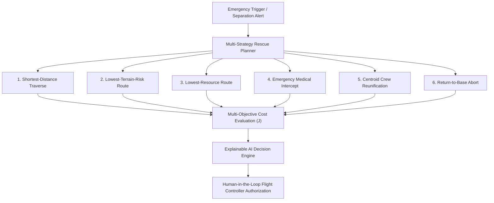

# Mars Pathfinder — Autonomous Emergency Rescue & Reunification Algorithms

> **DOCUMENT CLASSIFICATION: ALGORITHMIC SPECIFICATION & MATHEMATICAL FORMULATION**  
> **MISSION SUITE: MARS MISSION OPERATIONS (PHASE 2)**  
> **PLANETARY GEODETIC DATUM: IAU 2000 MARS SPHERE ($R = 3,396,190\text{ m}$)**  

---

## 1. Executive Summary

When Martian surface exploration sorties encounter environmental disruptions, physiological trauma, spacesuit breaches, or mobility failures, immediate algorithmic trajectory calculation is required to dispatch assistance or reunite dispersed crew members.

The Mars Pathfinder **Emergency Rescue & Reunification Engine** computes and compares **six distinct candidate strategies** in parallel, evaluating geodesic path lengths, topographic slope penalties, life-support consumable expenditures, and RF line-of-sight availability.

---

## 2. Multi-Objective Cost Function Formulation

Each candidate route $r$ is evaluated according to a normalized multi-objective objective cost function $J(r)$:

$$J(r) = w_d \hat{D}(r) + w_t \hat{T}(r) + w_s \hat{S}(r) + w_r \hat{R}(r) + w_c \hat{C}(r)$$

Where:
- $\hat{D}(r) \in [0, 1]$: Normalized geodesic distance.
- $\hat{T}(r) \in [0, 1]$: Normalized estimated transit duration.
- $\hat{S}(r) \in [0, 1]$: Topographic slope hazard score ($S = \frac{1}{N} \sum_{i=1}^N (\theta_i / \theta_{\text{max}})^2$).
- $\hat{R}(r) \in [0, 1]$: Consumable utilization fraction (Oxygen and battery power relative to reserve).
- $\hat{C}(r) \in [0, 1]$: Communication link blackout penalty (1.0 for blackout, 0.0 for direct LOS).
- $w_d, w_t, w_s, w_r, w_c$: Weight vector dynamically tuned to the operational scenario.

---

## 3. The Six Candidate Rescue Strategies

### Strategy 1: Shortest-Distance Geodesic Trajectory
- **Objective:** Minimize total linear distance traveled.
- **Trajectory:** Great-circle geodesic directly connecting rescuer/rover and target.
- **Velocity:** Nominal EVA walking pace ($0.80\text{ m/s}$).
- **Terrain Risk:** Moderate ($38/100$) — traverses terrain directly regardless of slope variations.
- **Optimal Context:** Sudden suit oxygen leaks where remaining time is the strictly limiting constraint ($T_{\text{margin}} < 45\text{ min}$).

### Strategy 2: Lowest-Terrain-Risk Route (Low-Slope Contour Bypass)
- **Objective:** Avoid hazardous slopes, boulder talus fields, and crater scarps.
- **Trajectory:** Contour-following path detouring around slopes exceeding $10.0^\circ$ (average path length $+28\%$).
- **Velocity:** Controlled pace ($0.75\text{ m/s}$).
- **Terrain Risk:** Minimal ($14/100$) — maintains traversability on safe flat regolith.
- **Optimal Context:** Severe dust storms with zero visibility (Scenario A) or rover mobility degradation where roll-over risk is critical.

### Strategy 3: Lowest-Resource Consumption Route
- **Objective:** Conserve astronaut metabolic oxygen and suit electrical reserves.
- **Trajectory:** Energy-optimized pace ($0.65\text{ m/s}$), avoiding steep uphill climbs that spike cardiac load.
- **Oxygen Consumption:** $28.0\text{ L/h}$ (vs nominal $35.0\text{ L/h}$).
- **Optimal Context:** Extended return sorties where base reserves are low and no acute trauma exists.

### Strategy 4: Emergency Medical Sprint
- **Objective:** Maximum-velocity intercept to stabilize an injured explorer.
- **Trajectory:** High-speed sprint or rover dispatch at $1.50\text{ m/s}$.
- **Equipment:** Transports emergency trauma pack, orthopedic splints, and portable oxygen umbilical.
- **Terrain Risk:** Elevated ($58/100$) — accepts higher physical traversal risk to minimize time-to-treatment.
- **Optimal Context:** Scenario B (Astronaut Injury, tachycardia $>135\text{ BPM}$, or hemorrhagic shock).

### Strategy 5: Symmetric Crew Reunification (Centroid Rendezvous)
- **Objective:** Reunite multiple dispersed astronauts into a single cohesive squad.
- **Rendezvous Point:** Spatial geographic centroid $(\bar{\phi}, \bar{\lambda})$:

$$\bar{\phi} = \frac{1}{K} \sum_{k=1}^K \phi_k, \quad \bar{\lambda} = \frac{1}{K} \sum_{k=1}^K \lambda_k$$

- **Optimization Criterion:** Minimizes the maximum transit time $\max_k(t_k)$ across all separated sub-teams.
- **Optimal Context:** Scenario C (RF Comms Loss) or wide squad dispersion ($>1200\text{ m}$).

### Strategy 6: General Mission Abort (Return-to-Base)
- **Objective:** Complete mission abort directing all exploration assets back to pressurized habitat.
- **Destination:** Ares Base Alpha ($[\phi_{\text{base}}, \lambda_{\text{base}}]$).
- **Optimal Context:** Severe regional dust storms (optical depth $\tau > 3.5$) or cascading multi-system failures (Scenario F).

---

## 4. Scenario-to-Strategy Decision Matrix

The AI Decision Engine evaluates active scenario telemetry and recommends candidate strategies according to the following decision hierarchy:

| Active Contingency Scenario | Primary Strategy Priority | Secondary Strategy | Decision Rationale |
| :--- | :--- | :--- | :--- |
| **Scenario A: Dust Storm** | `LOWEST_TERRAIN_RISK` | `RETURN_TO_BASE` | Optical extinction makes steep slopes fatal; priority is flat terrain navigation and habitat withdrawal. |
| **Scenario B: Astronaut Injury** | `EMERGENCY_MEDICAL` | `SHORTEST_DISTANCE` | Time-to-treatment is paramount; medical triage overrides energy conservation. |
| **Scenario C: Comms Blackout** | `CREW_REUNIFICATION` | `SHORTEST_DISTANCE` | Converging to mutual visual range restores UHF mesh communications. |
| **Scenario D: Suit Depressurization** | `SHORTEST_DISTANCE` | `EMERGENCY_MEDICAL` | Rapid 45-minute $\text{O}_2$ exhaustion envelope requires direct intercept sprint. |
| **Scenario E: Rover Breakdown** | `LOWEST_TERRAIN_RISK` | `CREW_REUNIFICATION` | Foot traverse requires avoiding rover recovery hazards and rendezvous for support. |
| **Scenario F: Compound Emergency** | `EMERGENCY_MEDICAL` | `RETURN_TO_BASE` | Triage priority: stabilize human life first, then abort to base shelter. |

---

## 5. Waypoint Trajectory Generation

For each candidate strategy, the engine interpolates a sequence of $N$ surface waypoints ($N \in [8, 14]$) along the spherical geodesic:

$$\phi_i = \arcsin\left(\sin\phi_1 \cos\delta_i + \cos\phi_1 \sin\delta_i \cos\theta\right)$$
$$\lambda_i = \lambda_1 + \text{atan2}\left(\sin\theta \sin\delta_i \cos\phi_1, \cos\delta_i - \sin\phi_1 \sin\phi_i\right)$$

Where:
- $\delta_i = \frac{d_i}{R_{\text{Mars}}}$ is the angular distance fraction.
- $\theta$ is the forward initial bearing from origin to destination.
- Each waypoint stores latitude, longitude, elevation ($m$), slope ($^\circ$), cumulative distance ($\text{km}$), and ETA ($\text{seconds}$).
