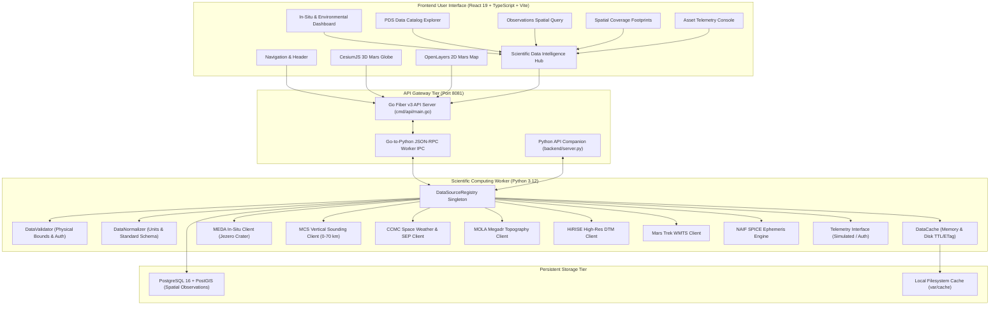

# System Architecture & Live Data Foundation
## Mars Pathfinder — Phase 1 Technical Specification

This document details the software architecture, data pipelines, communication interfaces, and security model implemented in Phase 1: Live Data Foundation & Mission Intelligence Architecture.

---

## 1. System Architecture Overview

Mars Pathfinder follows a decoupled, resilient multi-tier architecture designed for high-performance planetary geospatial visualization, scientific computation, and mission telemetry ingestion.

---

## 2. API Endpoints Specification (Phase 1)

All endpoints are standardized across both the authoritative Go Fiber v3 API gateway (`cmd/api/main.go`) and the Python companion server (`backend/server.py`):

| Method | Endpoint | Description | Auth / Security |
| :--- | :--- | :--- | :--- |
| `GET` | `/api/v1/data-sources` | List all 7 registered NASA PDS data sources with metadata. | Public |
| `GET` | `/api/v1/data-sources/{id}` | Retrieve single data source metadata by key or UUID. | Public |
| `GET` | `/api/v1/data-products` | List available data products filtered by source key or instrument. | Public |
| `GET` | `/api/v1/observations` | Query observations by latitude, longitude, and search radius ($km$). | Public |
| `GET` | `/api/v1/observations/latest` | Retrieve latest observation record for a source/instrument. | Public |
| `GET` | `/api/v1/observations/coverage`| Retrieve spatial bounding boxes and resolutions across datasets. | Public |
| `GET` | `/api/v1/data-status` | System data health, active sources, and cache statistics. | Public |
| `GET` | `/api/v1/data-quality` | Data validation rule compliance and quality metrics. | Public |
| `GET` | `/api/v1/mars-conditions` | Synthesized multi-source environmental conditions for coordinates. | Public |
| `GET` | `/api/v1/hazards/observed` | Real-time space weather, dust storm, and thermal hazards. | Public |
| `POST` | `/api/v1/telemetry/ingest` | Ingest telemetry packet (`SIMULATED`, `TEST`, or `AUTHENTICATED`).| Cryptographic Check |
| `GET` | `/api/v1/telemetry/latest` | Retrieve latest telemetry packet for an asset (e.g. perseverance).| Public |

---

## 3. Data Integrity & In-Situ vs Climatology Separation

A critical mandate of Phase 1 is scientific truthfulness:
1. **Jezero In-Situ Range ($\le 60\text{ km}$)**:
   - When querying conditions within 60 km of Jezero Crater ($18.38^\circ\text{N}, 77.58^\circ\text{E}$), `get_mars_conditions` returns `IN_SITU_OBSERVED` with `status: "OBSERVED"` for all MEDA sensors:
     - Pressure: $P \approx 740 - 765\text{ Pa}$
     - Air Temperature: $T_{air} \approx -65^\circ\text{C}$ to $-15^\circ\text{C}$
     - Ground Skin Temperature: $T_{ground} \approx -75^\circ\text{C}$ to $+10^\circ\text{C}$
     - Wind Vector: $v \approx 4.2\text{ m/s}$, $\theta \approx 135^\circ$
     - Relative Humidity: $RH \approx 8.5\%$
     - Dust Optical Depth: $\tau \approx 0.42$
     - UV Flux Index: $\approx 4.2 / 10$
2. **Global / Regional Range ($> 60\text{ km}$)**:
   - When querying coordinates outside Jezero Crater:
     - Pressure and Air Temperature are marked as `MODELLED (NASA Ames Mars GCM)`.
     - Surface wind vectors, ground skin temperature, relative humidity, and UV flux index are explicitly marked as `UNAVAILABLE` (`status: "UNAVAILABLE"` with `null` values).
     - The UI displays an explicit scientific banner indicating that no active surface station exists at that location, refusing to display fake or synthetic measurements as observed ground truth.

---

## 4. Telemetry Ingestion Security & Validation Architecture

The telemetry pipeline is architected for mission robustness:
- **Synthetic Simulation (`SIMULATED`)**:
  - Allowed for mission planning, driver training, and user demonstration.
  - Automatically marked with `is_synthetic: true`.
  - Displayed in the UI with distinct orange dashed border and mandatory simulation notice.
- **External Telemetry (`AUTHENTICATED_EXTERNAL_TELEMETRY`)**:
  - Packets asserting this mode must provide a valid cryptographic signature (`authentication_signature`).
  - `DataValidator.validate_telemetry_auth()` enforces signature verification.
  - Unauthenticated packets claiming external telemetry are rejected immediately.
- **Physical Boundary Enforcement**:
  - Telemetry parameters (voltages, temperatures, motor currents) are validated against rover subsystem operating envelopes before persistence.

---

## 5. Caching & Resilience Model

1. **Dual Cache (`DataCache`)**:
   - Memory Cache: In-memory dictionary with sub-millisecond lookup and TTL expiration.
   - Disk Cache: Persistent filesystem cache (`var/cache/data_sources/`) with SHA-256 hash keys and HTTP ETag support.
2. **Rate Limiting & Backoff (`BaseDataSourceClient`)**:
   - Token-bucket rate limiting prevents exceeding upstream NASA PDS or CCMC API limits.
   - Exponential backoff retry logic ($1\text{s}, 2\text{s}, 4\text{s}$) with jitter handles transient network glitches.
3. **SSRF Whitelisting**:
   - Outbound HTTP requests are restricted to authentic NASA and academic planetary nodes (`*.nasa.gov`, `*.nmsu.edu`, `*.wustl.edu`, `*.arizona.edu`). Outbound connections to local/private network ranges are prohibited.
