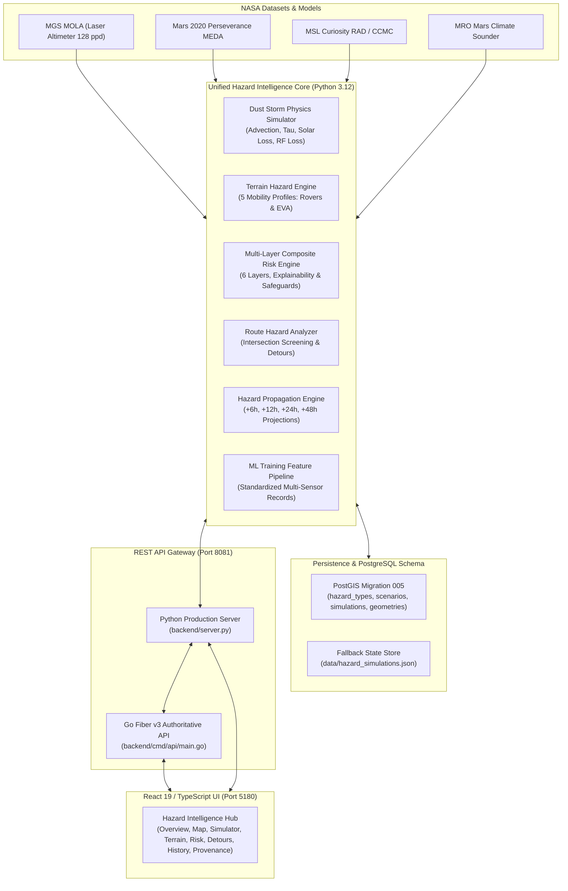

# Mars Pathfinder — Phase 3: Advanced Hazard Simulation & Environmental Risk Intelligence Architecture

## 1. System Overview

Phase 3 establishes an authoritative, physics-grounded **Unified Planetary Hazard Engine** within the Mars Pathfinder platform. It models atmospheric, surface, space radiation, and operational hazards across Martian coordinates, providing configurable dust storm simulation, multi-profile mobility trafficability, explainable composite environmental risk calculation, dynamic route threat screening, and ML feature pipeline preparation.

---

## 2. Mathematical & Physical Formulations

### 2.1 Atmospheric Dust Storm Radiative & RF Transfer
1. **Optical Depth ($\tau$) Radial Distribution**:
   From storm core radius $R_{core} = 0.35 \cdot R_{outer}$ to outer perimeter:
   $$\tau(r) = \begin{cases}
   \tau_{peak} & r \le R_{core} \\
   \tau_{ambient} + (\tau_{peak} - \tau_{ambient}) \cdot \exp\left(-2.2 \left(\frac{r - R_{core}}{R_{outer} - R_{core}}\right)^2\right) & R_{core} < r \le R_{outer} \\
   \tau_{ambient} \approx 0.45 & r > R_{outer}
   \end{cases}$$

2. **Solar Flux Curtailment (Beer-Lambert Absorption)**:
   $$I(\tau) = I_0 \cdot \exp\left(-\frac{\tau}{\cos\theta_z}\right)$$
   Where nominal diurnal zenith angle $\cos\theta_z \approx 0.707$. The photovoltaic power loss percentage is:
   $$\Delta P_{solar}\% = \min\left(99.5\%, \left(1.0 - \exp\left(-\frac{\tau}{0.707}\right)\right) \times 100\%\right)$$

3. **RF Signal Path Attenuation**:
   Empirical Martian dust aerosol scattering model across Ka, X, and UHF frequencies:
   $$A_{dB} = \min\left(45.0\text{ dB}, 1.8 \cdot \tau + 0.15 \cdot \left(\frac{v_{wind}}{10}\right)^{1.5}\right)$$

4. **Diurnal Temperature Damping**:
   - Surface daytime cooling: $\Delta T_{day} = -4.2 \cdot \min(\tau, 6.0) \text{ }^\circ\text{C}$
   - Nighttime greenhouse aerosol thermal trapping: $\Delta T_{night} = +2.6 \cdot \min(\tau, 4.5) \text{ }^\circ\text{C}$

---

## 3. Multi-Profile Mobility Architecture

Phase 3 introduces rigorous engineering specifications for five distinct surface exploration profiles:

| Mobility Profile | Vehicle / Agent Mass | Max Safe Slope | Impassable Slope | Max Roughness | Nominal Speed | Primary Hazard Mode |
|---|---|---|---|---|---|---|
| `HEAVY_ROVER` | 1025 kg (Perseverance/Curiosity) | 15.0° | 20.0° | 0.28 m | 0.042 m/s (~150 m/h) | Cleat wear & bedrock stranding |
| `LIGHT_SCOUT_ROVER` | 35 kg (Autonomous micro-rover) | 24.0° | 30.0° | 0.16 m | 0.15 m/s (~540 m/h) | Low clearance boulder high-centering |
| `PRESSURIZED_CREW_ROVER` | 4200 kg (Habitable cabin rover) | 18.0° | 23.0° | 0.45 m | 2.22 m/s (~8.0 km/h) | Side-slope rollover momentum |
| `ASTRONAUT_EVA_WALK` | 130 kg (Suited astronaut + PLSS) | 22.0° | 30.0° | 0.30 m | 0.85 m/s (~3.0 km/h) | Scree slip & boot puncture |
| `EMERGENCY_SPRINT` | 130 kg (Max exertion evacuation) | 14.0° | 22.0° | 0.20 m | 1.95 m/s (~7.0 km/h) | Tripping fall & acute cardiac strain |

---

## 4. Multi-Layer Composite Environmental Risk Engine

The composite risk score $S \in [0.0, 100.0]$ is computed as a weighted sum of 6 scientific factor scores:
$$S = \sum_{i=1}^6 w_i \cdot s_i$$

Normalized default scientific weights:
- $w_{atm} = 0.22$ (Atmospheric Dust Opacity & Wind)
- $w_{surf} = 0.24$ (Topographic Slope & Surface Roughness)
- $w_{rad} = 0.18$ (Galactic Cosmic Radiation & Atmospheric Column Shielding)
- $w_{sol} = 0.16$ (Photovoltaic Solar Power Obscuration)
- $w_{comms} = 0.10$ (RF Communications Line-of-Sight & Shadow)
- $w_{op} = 0.10$ (Cryogenic Cold Stress & Life Support Metabolic Drain)

$$\sum_{i=1}^6 w_i = 1.00$$

### Strict Missing Data Safeguard
If a physical sensor stream is offline or missing:
1. The system **never** defaults to zero risk.
2. A conservative baseline risk score (42.0 – 55.0) is assigned.
3. The uncertainty margin expands (up to $\pm 38\%$).
4. Tagged explicitly with `DataClassification.UNAVAILABLE`.
5. An operational warning is injected into the explainability scorecard.

---

## 5. REST API & Worker Specification

All endpoints are implemented identically in both the Go Fiber v3 backend (`backend/cmd/api/main.go` / `backend/internal/worker/worker.go`) and the Python server (`backend/server.py`):

| Endpoint | Method | Description |
|---|---|---|
| `/api/v1/hazards/types` | GET | Catalog of categorized Mars hazards and default weights |
| `/api/v1/hazards/scenarios` | GET | List of predefined benchmark scenarios (MY34, MY28, Jezero, Gale, Hellas) |
| `/api/v1/hazards/simulations` | GET | List all active simulation runs and their current states |
| `/api/v1/hazards/simulations/:id` | GET | Detailed simulation state with short-term forward projections |
| `/api/v1/hazards/simulations/dust-storm` | POST | Instantiate a new dust storm simulation from benchmark or custom parameters |
| `/api/v1/hazards/simulations/:id/step` | POST | Advance simulation clock by $\Delta t$ hours |
| `/api/v1/hazards/simulations/:id/pause` | POST | Pause running simulation |
| `/api/v1/hazards/simulations/:id/resume` | POST | Resume paused simulation |
| `/api/v1/hazards/simulations/:id/reset` | POST | Reset simulation to genesis state |
| `/api/v1/hazards/simulations/:id` | DELETE | Remove simulation run |
| `/api/v1/hazards/risk-assessment/point` | GET / POST | Calculate explainable composite risk at point with optional sensor outage flags |
| `/api/v1/hazards/risk-assessment/route` | POST | Screen expedition route against active storm and generate alternate bypass corridor |
| `/api/v1/hazards/terrain-evaluation` | GET / POST | Evaluate terrain and trafficability across all 5 mobility profiles |
| `/api/v1/hazards/ml-features` | GET | Extract standardized multi-sensor training feature vectors for Phase 4 ML |
| `/api/v1/hazards/historical` | GET | Retrieve historical catalog of recorded Mars dust storms and mission impacts |
